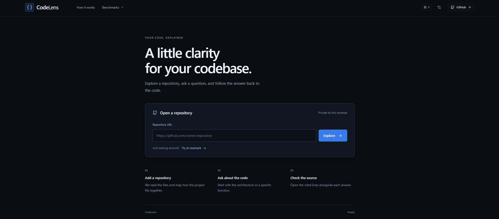
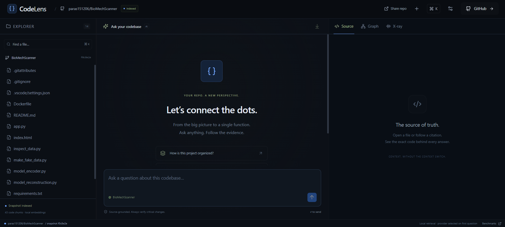
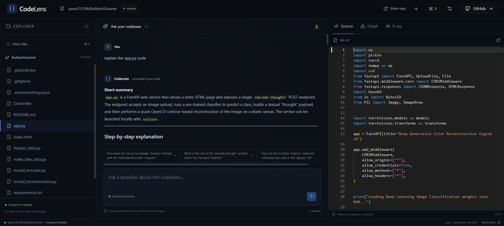
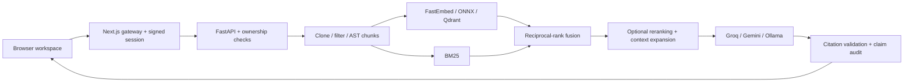

# CodeLens

Explore a public GitHub repository, ask questions, and follow each answer back to the code.

**[Try the live app](https://codelens-phi-six.vercel.app/)** · **[Source](https://github.com/paras151206/codelens)**



*Homepage, October 17, 2026.*

### Indexed workspace

Browse the repository's files and ask questions alongside the source viewer.



### Answer and source code

An explanation of `app.py` with the source open alongside it.



## What it does

- Indexes public GitHub repositories into searchable source-code snapshots.
- Answers questions about architecture, functions, and implementation with clickable file-and-line citations.
- Supports follow-up questions, source browsing in Monaco, a heuristic dependency graph, and retrieval diagnostics.
- Checks citation ranges and flags claims that may lack supporting evidence.
- Keeps each browser session's repository list and chats separate. Visitors can remove their own repositories and chat history.

## How the RAG pipeline works

CodeLens retrieves relevant code before asking a language model to explain it.

1. **Clone and filter:** fetch a shallow Git snapshot, enforce resource limits, and skip binary/build files. Repository code is never executed.
2. **Parse and chunk:** use Tree-sitter for function, class, and method boundaries in supported languages; use overlapping line windows for other text. Preserve filenames, symbols, imports, and original line ranges.
3. **Embed locally:** FastEmbed runs the configured MiniLM model through ONNX, with an on-disk embedding cache. Vectors stay in embedded Qdrant.
4. **Retrieve:** combine semantic similarity with BM25 keyword search using reciprocal-rank fusion. Query planning can rewrite follow-up questions and generate subqueries; context expansion adds nearby code.
5. **Generate:** send retrieved snippets to a configured Groq, Gemini, or Ollama model and stream the answer. Provider discovery, fallback, and deadlines handle unavailable or slow responses.
6. **Check:** validate source citation ranges and run a best-effort claim-support audit. The app can abstain when retrieval confidence is low.

Optional FlashRank reranking is available. The deployed low-memory profile disables it, uses small embedding batches, and allows one chat at a time. Semantic and keyword retrieval remain enabled.



## Stack

| Layer | Tools |
|---|---|
| Frontend | Next.js App Router, React, TypeScript, Monaco |
| Backend | Python, FastAPI, streamed SSE responses |
| Parsing | Tree-sitter and line-window fallback |
| Retrieval | FastEmbed, ONNX, Qdrant, BM25, reciprocal-rank fusion |
| Storage | Filesystem snapshots and indexes, SQLite conversations |
| Hosting | Vercel frontend, Render Docker backend |

## Privacy and storage

The gateway creates a signed, HttpOnly, SameSite=Lax cookie, marked Secure in production. The backend enforces session ownership for repository lists, status, events, source files, chat, conversations, and deletion. Knowing another visitor's repository URL does not grant access. Legacy shared indexes are inaccessible.

This is **browser-session isolation, not account login**. People sharing one browser profile share a workspace. Cookies expire after seven days. Clearing cookies or switching browsers does not carry workspace access across.

Snapshots are stored to support search and follow-up questions. Remove them and their chat history from **Your workspace**. Repository quotas apply per session; the server still has shared concurrency limits. The Share button copies the public GitHub URL, not access to a private workspace.

Provider keys and the backend access token stay server-side. Retrieved source snippets and questions are sent to the configured language-model provider; embeddings are generated locally.

## Run locally

Requirements: Node.js 22+, Git, and [uv](https://docs.astral.sh/uv/getting-started/installation/). The setup script prepares Python dependencies and frontend assets.

```sh
git clone https://github.com/paras151206/codelens.git
cd codelens
node scripts/dev.mjs --setup
```

Edit `backend/.env` and configure at least one generation provider:

```dotenv
GROQ_API_KEY=your_key_here
GROQ_MODELS=
# Optional fallback:
GEMINI_API_KEY=
GEMINI_MODELS=
```

Leave model preferences blank for discovery, or supply preferred model IDs supported by your provider. For local generation, configure `OLLAMA_URL` and `OLLAMA_MODELS` after installing a model in Ollama. The examples contain placeholders only.

`frontend/.env.local` uses `CODELENS_API_URL=http://localhost:8000`. If the backend has `ACCESS_TOKEN` configured, set the matching `CODELENS_ACCESS_TOKEN` in the frontend environment.

```sh
node scripts/dev.mjs
```

Open **http://localhost:3000**. Backend API documentation is at **http://localhost:8000/docs**. The first local indexing request may download the embedding model. Run only one backend worker against a data directory.

## Configuration and deployment

See [`backend/.env.example`](backend/.env.example) and [`frontend/.env.example`](frontend/.env.example).

| Setting | Purpose |
|---|---|
| `GROQ_API_KEY`, `GEMINI_API_KEY` | Backend-only generation credentials |
| `GROQ_MODELS`, `GEMINI_MODELS`, `OLLAMA_MODELS` | Preferred model IDs |
| `OLLAMA_URL` | Optional local generation endpoint |
| `EMBEDDING_MODEL`, `EMBEDDING_CACHE_DIR` | Local embedding model and model cache |
| `RERANK_ENABLED`, `RERANKER_MODEL` | Optional reranker |
| `LOW_MEMORY` | Skip reranking and serialize chat; enabled in Docker |
| `DATA_DIR` | Snapshots, indexes, embedding cache, and conversations |
| `MAX_REPOS` | Repository slots per browser session |
| `MAX_REPO_MB`, `MAX_FILES`, `MAX_CHUNKS`, `CLONE_TIMEOUT` | Ingestion resource limits |
| `ACCESS_TOKEN` | Required protection for a publicly hosted backend |
| `CODELENS_API_URL` | Backend origin, set on the Next.js server |
| `CODELENS_ACCESS_TOKEN` | Matches backend `ACCESS_TOKEN`; also signs session cookies |

**Vercel:** import the repository with root directory `frontend`. Set `CODELENS_API_URL` to the Render origin and `CODELENS_ACCESS_TOKEN` to the backend token. Never prefix credentials with `NEXT_PUBLIC_`.

**Render:** use the root [`Dockerfile`](Dockerfile) or [`render.yaml`](render.yaml). Configure provider keys, `ACCESS_TOKEN`, and the frontend origin in `CORS_ORIGINS`. The health endpoint is `/api/health`. The Docker build bundles the default embedding model to avoid downloading it during a cold start.

**Local Docker:**

```sh
docker build -t codelens-api .
docker run --rm -p 7860:7860 --env-file backend/.env -v codelens-data:/app/data codelens-api
```

Use `CODELENS_API_URL=http://localhost:7860` for the frontend in this setup.

## Verification

```sh
cd backend
uv run pytest -q
uv run ruff check app tests
cd ../frontend
node tests/gateway.cjs
npm run lint
npm run build
```

As of October 17, 2026, **37 backend tests passed**, along with gateway checks and the frontend production build. Tests cover parsing, retrieval, citations, provider fallback and timeouts, session ownership, conversation isolation, deletion, and indexing completion order.

Live checks used two separate visitor sessions to verify private lists, independent quotas, same-URL isolation, denied cross-visitor access, and owner-only removal. A previous end-to-end check indexed RESQ's 118 files into 680 sections and exercised chat, citation navigation, and conversation reload.

### Retrieval evaluation

```sh
cd backend
uv run python -m app.eval.run --k 5
```

The harness compares retrieval on 32 labeled questions across pinned ItsDangerous and MarkupSafe revisions. The [saved October 2 benchmark](docs/benchmark-results.json) is a historical development baseline, **not a measurement of the current hosted ONNX/low-memory configuration**. Rerun it for the configuration you deploy. Retrieval metrics do not measure end-to-end answer correctness.

## Current limitations

- Public GitHub repository roots only; private repositories and branch URLs are unsupported.
- Render's free instance can sleep and lose local data after a restart or redeploy. Reindexing may be necessary; large repositories take time on the small CPU allocation.
- Browser sessions are not authenticated user accounts or durable cross-device storage.
- Dependency edges are import heuristics, not complete compiler resolution.
- Citations and claim audits help inspect answers; they do not guarantee correctness.
- Provider quotas and availability still apply. Changing the embedding model requires reindexing.

## Project layout

```text
backend/app/api/         Endpoints, ownership checks, streaming, throttling
backend/app/ingestion/   Clone, filtering, parsing, and chunking
backend/app/retrieval/   Embeddings, hybrid search, planning, verification
backend/app/llm/         Provider discovery, streaming, fallback
backend/app/core/        Configuration and conversation storage
backend/app/eval/        Retrieval evaluation harness
backend/tests/          Backend tests
frontend/app/           Pages and server gateway
frontend/components/    Workspace, source viewer, graph, Markdown
frontend/lib/           API and streaming transport
scripts/                Local setup and development launcher
```
