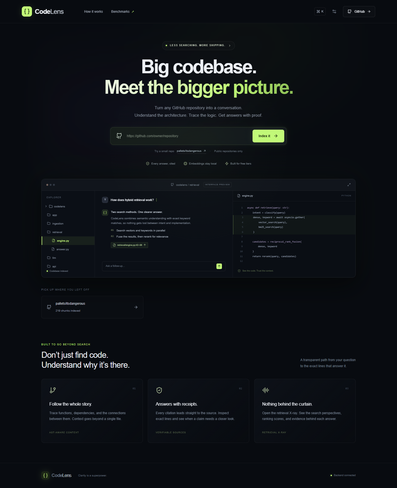
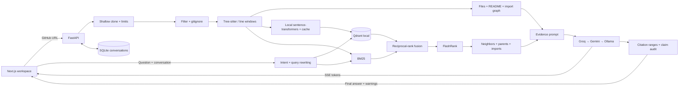

## Indexing reliability update (October 15, 2026)

The hosted backend uses FastEmbed/ONNX with one CPU thread and small batches instead of PyTorch. The Docker build bundles the MiniLM model so cold starts do not download it. Indexing progress uses short status requests, detects interrupted jobs after server restarts, and reuses existing repositories. Failed jobs do not consume the active repository quota. Provider keys remain server-only.

## Hosted setup (updated October 10, 2026)

Visitors never enter tokens or provider keys. Browser requests go through the Next.js server gateway.

- **Render / codelens-api / Environment:** add `GROQ_API_KEY` (required for Groq answers). Optionally add `GEMINI_API_KEY` for fallback. Save and deploy. Keep `ACCESS_TOKEN` set.
- **Vercel / codelens / Environment Variables:** `CODELENS_API_URL` is the backend origin; `CODELENS_ACCESS_TOKEN` must match Render's `ACCESS_TOKEN`. Both are server-only; do not use a `NEXT_PUBLIC_` prefix. These connection values are configured on the live project.
- Local frontend development uses `CODELENS_API_URL=http://localhost:8000`; add `CODELENS_ACCESS_TOKEN` only if your local backend requires it.

The public UI uses a restrained blue/black theme. No connection-token field, theme picker, decorative cursor glow, or fake chat preview is shown. The public gateway grants visitors access to the app's public-repository features, while keeping its backend credential private. It forwards only supported routes, rejects cross-origin requests, limits request sizes, and preserves streamed responses. Existing backend rate and concurrency limits still apply. This is a shared public-repository workspace; not a private multi-user account system.

# CodeLens

**Understand every line. Follow every claim to its source.**

CodeLens turns a public GitHub repository into a searchable, conversational workspace. It combines local ONNX embeddings, Qdrant, BM25, reciprocal-rank fusion, and optional FlashRank reranking with streamed, source-cited answers from Groq, Gemini, or local Ollama.



## Start here

Requirements: **Node.js 22+**, **Git**, and **[uv](https://docs.astral.sh/uv/getting-started/installation/)**. uv can install Python 3.12. Allow a few GB for Python libraries, downloaded models, and repository indexes. Docker is not required for local use.

From this project's root:

```sh
node scripts/dev.mjs --setup
```

This installs the locked dependencies, copies the example environment files only when missing, and prepares the locally served Monaco editor. Edit `backend/.env` and add a free-tier Groq key. A Gemini key is optional but enables cross-provider fallback. Environment variables take precedence over `.env`.

```dotenv
GROQ_API_KEY=your_free_tier_key
GROQ_MODELS=
GEMINI_API_KEY=
GEMINI_MODELS=
```

The strings above describe where to enter your own credentials; no credentials ship with this project. Leave preferred model lists blank to discover supported text-generation models automatically. To control selection, enter a comma-separated list of model IDs from your provider's current model list. **No generation-model IDs are embedded in application code.**

Start both services with one command:

```sh
node scripts/dev.mjs
# Or, with Make installed:
make dev
```

Open **http://localhost:3000**. API documentation: **http://localhost:8000/docs**. Press Ctrl+C to stop both services. The first indexing request downloads the configured embedding model; subsequent requests reuse the local model and embedding cache.

The local copy delivered here already has dependencies installed and examples configured. Add or update keys as needed, then use the start command above. Do not start a second backend against the same data directory.

### Get free API keys

1. **Groq:** sign in to the [Groq console](https://console.groq.com/keys), create an API key, and set `GROQ_API_KEY`. Follow the [official quickstart](https://console.groq.com/docs/quickstart). Use an account on the free plan; do not enable paid billing for this project.
2. **Gemini:** create a key in [Google AI Studio](https://aistudio.google.com/apikey), following the [API key guide](https://ai.google.dev/gemini-api/docs/api-key). Set `GEMINI_API_KEY`. Select a model available to your free-tier account; availability and quotas vary. Keep billing disabled.
3. **Ollama, optional:** install [Ollama](https://ollama.com), pull a text-generation model that fits your hardware, set `OLLAMA_URL=http://localhost:11434`, and set `OLLAMA_MODELS` to the installed model's exact name. Leave cloud keys blank for local-only inference. Pulling a model is a separate step; CodeLens discovers installed models but does not install them.

The app never enables billing, purchases capacity, or uses an embedding API. A provider's model-list endpoint does not certify that a model is free on your account. Free-only use therefore depends on using unbilled accounts and their allowed models. Local Ollama avoids that dependency. Free quotas can return rate-limit errors; retries and fallback handle availability, not billing policy.

## What is included

- Next.js App Router, TypeScript, Tailwind, Framer Motion, dark glass panels, animated ambient background, cursor glow, and three accent themes.
- URL ingestion with live SSE stages and counters, shallow Git snapshots, size/time limits, binary/build/lockfile filtering, `.gitignore` handling, and symlink rejection.
- Tree-sitter function/class/method chunks for Python, JavaScript, TypeScript/TSX, Java, C/C++, Go, and Rust; overlapping line windows for other text.
- Source paths, line ranges, symbols, parent classes, imports, contextual embedding headers, file tree, an extractive README summary, and a heuristic import graph.
- Local sentence-transformer embeddings and disk cache; embedded Qdrant; BM25; reciprocal-rank fusion; optional tiny FlashRank cross-encoder.
- Intent classification, conversation-aware query rewriting and subqueries, context expansion to nearby chunks/classes/imports, streamed answers, and follow-up suggestions.
- Exact citation-range validation plus an LLM claim-support audit. Invalid ranges are removed; unsupported claims are flagged in the UI. Verification is a best-effort aid, not a proof of correctness.
- Confidence-based abstention, persistent conversation memory in SQLite, recent repositories, shareable repository links, and Markdown conversation export.
- Three resizable panes, file search, locally served Monaco source viewer with citation highlights, Retrieval X-ray scores, and an interactive force-directed dependency graph.
- Command palette (`Ctrl/Cmd+K`), chat focus (`Ctrl/Cmd+/`), responsive mobile tabs, keyboard focus states, reduced-motion support, toasts, skeletons, and error states.
- A 32-question, two-repository evaluation harness, measured benchmark data, animated benchmark page, tests, CI, Dockerfile, and deployment configuration.

The landing page's small demonstration is explicitly labeled **interface preview**. Indexing, chat, scores, source navigation, and benchmark results in the workspace use backend data.

## Architecture



```text
backend/app/
  api/          HTTP endpoints, SSE, authentication, throttling
  core/         Environment settings and persistent conversation storage
  ingestion/    Safe clone/filter pipeline and AST chunking
  retrieval/    Embedding cache, hybrid index, planning and verification
  llm/          Provider interface, discovery, streaming and fallback
  models/       Request validation and chunk metadata
  eval/         Pinned repositories, 32 labels, metrics and CLI harness
backend/tests/  Chunking, fusion, citations, providers, API and validation
frontend/app/   Landing/workspace and benchmark routes
frontend/components/  Workspace, Markdown, Monaco and graph
frontend/hooks/ Keyboard shortcut lifecycle
frontend/lib/   Typed API and streaming transport
scripts/       Cross-platform setup/start
```

Provider discovery runs on startup and again after provider failure. Configured preferred model IDs win when available; otherwise discovery selects a text model using available context-window metadata. Errors, rate limits, empty streams, and unavailable models trigger bounded retries and then the next configured provider. Partial output is reset before retrying so answers from different attempts are never mixed.

## Evaluation

Run from `backend`:

```sh
uv run python -m app.eval.run
# Optionally change k (1–24):
uv run python -m app.eval.run --k 10
```

No LLM key is needed. This clones pinned revisions of [ItsDangerous](https://github.com/pallets/itsdangerous) and [MarkupSafe](https://github.com/pallets/markupsafe), builds local indexes, validates all labels, and compares three strategies. Output is written atomically to `backend/data/benchmark.json`, which the Benchmark page reads. A copy of this delivery's run is in `docs/benchmark-results.json`.

**Measured October 2, 2026 — 32 questions, k=5:**

| Strategy | Recall@5 | MRR | Mean query latency |
|---|---:|---:|---:|
| Dense | 0.719 | 0.426 | 2.4 ms |
| Hybrid | 0.688 | 0.500 | 3.1 ms |
| Hybrid + rerank | 0.750 | 0.549 | 79.2 ms |

These are actual measurements, including the lower hybrid recall. Labels identify a source file and symbol, optionally a parent class. Recall measures the proportion of labeled targets found, and MRR measures the first relevant chunk's reciprocal rank. There is one target per question in the bundled dataset, so Recall@5 also equals Hit@5 for this dataset.

All query embeddings and reranker initialization are warmed equally before timing; query-result caches start empty. Latency excludes cloning, indexing, model download, LLM planning, answer generation, verification, and frontend rendering. No LLM rewriting or neighbor expansion is used in this comparison. Results are a small development baseline, not a held-out accuracy claim. Model IDs and exact repository commits are recorded with each run. MiniLM is a small general-purpose embedding baseline that can represent code; use the configurable model setting to evaluate code-specialized alternatives.

## Verification

```sh
cd backend
uv run pytest -q
uv run ruff check app tests
cd ../frontend
npm run lint
npm run build
```

The backend suite covers all requested parser languages, source line fidelity, overlapping fallback windows, RRF agreement, fabricated citations, model discovery, partial-stream resets, provider fallback, URL validation, authorization, file traversal rejection, SSE abstention, and persisted memory. GitHub Actions runs backend lint/tests and the frontend type check/production build.

Tree-sitter is deliberately pinned to `0.25.2` with language-pack `0.9.0`. A real-repository Windows test exposed a native access violation with `0.26.0`; keep the compatible pair together when upgrading.

## Configuration

See `backend/.env.example` and `frontend/.env.example` for the full starting configuration.

| Variable | Purpose |
|---|---|
| `GROQ_API_KEY`, `GEMINI_API_KEY` | Server-only free-tier credentials |
| `GROQ_MODELS`, `GEMINI_MODELS`, `OLLAMA_MODELS` | Comma-separated preferred discovered model IDs |
| `OLLAMA_URL` | Enable the optional local provider |
| `EMBEDDING_MODEL` | Local sentence-transformer model; required |
| `RERANKER_MODEL`, `RERANK_ENABLED` | Local FlashRank model and toggle |
| `DATA_DIR` | Repository snapshots, vectors, model/embedding cache and conversations |
| `CORS_ORIGINS` | Exact comma-separated allowed frontend origins |
| `ACCESS_TOKEN` | Optional shared backend bearer token; set on public deployments |
| `MAX_REPO_MB`, `MAX_FILE_BYTES`, `MAX_FILES`, `MAX_CHUNKS` | Ingestion resource limits |
| `MAX_REPOS`, `CLONE_TIMEOUT` | Repository count and clone timeout |
| `MIN_DENSE_SCORE` | Confidence threshold to calibrate on your repositories |
| `NEXT_PUBLIC_API_URL` | Public backend origin, set before frontend build |

Changing the embedding model requires reindexing; the backend rejects incompatible existing repository indexes. Stop the backend before moving or removing old directories under `DATA_DIR`. Keep one backend worker: embedded Qdrant owns filesystem locks. No repository code is executed, Git hooks and LFS downloads are disabled, and submodules are not initialized. Public GitHub repository roots only; private repositories, branch URLs, and arbitrary URLs are rejected.

## Deploy

### Frontend: Vercel Hobby

1. Push the project to your GitHub repository.
2. Import it in Vercel, choose the **Hobby** plan, and set the project root to `frontend`.
3. Set `CODELENS_API_URL` to the HTTPS backend origin and `CODELENS_ACCESS_TOKEN` to the Render access token. Redeploy when these values change.
4. Deploy with the included Next.js configuration. `npm ci` prepares local Monaco assets automatically.
5. Add the exact Vercel origin to backend `CORS_ORIGINS`. The server gateway supplies the backend token; visitors do not enter it.

Check the [Hobby plan terms](https://vercel.com/docs/plans/hobby); it is for personal, non-commercial use. Do not enable paid add-ons for this project.

### Backend: Render Free

1. Create a Render Blueprint from `render.yaml`, or a Docker Web Service using the root `Dockerfile`.
2. Explicitly choose **Free**. Add the provider keys, model configuration, exact frontend origin, and a long random `ACCESS_TOKEN` in the service's environment settings.
3. The container listens on Render's `PORT`; the health route is `/api/health`. Use one worker.
4. Set the deployed backend URL in Vercel, deploy the frontend, and index a small repository.

Read [Render's free-service limits](https://render.com/docs/free). Free services sleep and lose local data on restart/redeploy; repositories must be reindexed. They also have small memory budgets: the PyTorch/sentence-transformer stack may exceed the available RAM during model loading or concurrent work. This deployment configuration is provided, but a successful full RAG workload on Render Free is **not guaranteed or verified**. Keep local hosting as the reliable zero-service-cost option; do not upgrade automatically to a paid instance. Use an unbilled account/spend controls to avoid bandwidth or build overages.

### Backend: Hugging Face Docker Spaces

The Dockerfile runs on port 7860 with UID 1000 and writable `/app/data`. If your account is eligible for a no-cost Docker Space, create one and push this project. Add the following front matter at the very top of the Space's README:

```yaml
---
title: CodeLens API
sdk: docker
app_port: 7860
---
```

Set provider keys as Space secrets and other `.env.example` values as variables. Set CORS to your frontend's origin. Then use the Space's HTTPS endpoint as `NEXT_PUBLIC_API_URL`.

**Eligibility caveat, checked October 2, 2026:** the current [Spaces overview](https://huggingface.co/docs/hub/spaces-overview) requires a paid plan to create a Docker Space. New Docker Spaces therefore do not meet this project's free-only requirement. Do not subscribe or choose paid hardware. The deployment instructions are for existing eligible environments; the container also runs locally without a hosted service.

### Local Docker, optional

```sh
docker build -t codelens-api .
docker run --rm -p 7860:7860 --env-file backend/.env -v codelens-data:/app/data codelens-api
```

Set frontend `NEXT_PUBLIC_API_URL=http://localhost:7860` for this option. Docker itself was not available for a container build in this delivery environment; the local Python backend and Next.js production build are independently tested.

## Operational boundaries

This is a single-user or trusted-team app with an optional shared token, not a multi-tenant account system. Repository links share indexed snapshots; a recipient needs backend access. Conversation IDs stay in the initiating browser and are not part of repo share links. Source snippets are sent to your configured LLM provider; embeddings and vector storage stay local. Dependency edges are import-text heuristics, not complete compiler resolution. The README summary is extractive. Confidence and semantic audits can be wrong; inspect cited code before changing critical behavior. Initial model downloads require internet access, and cloud inference requires internet access; cached retrieval and local Ollama can work offline.

## Screenshots

- [Landing](docs/screenshots/landing.png) and [mobile landing](docs/screenshots/mobile.png)
- [Indexing pipeline](docs/screenshots/ingestion.png)
- [Source workspace](docs/screenshots/workspace.png)
- [Cited answer](docs/screenshots/answer.png)
- [Retrieval X-ray](docs/screenshots/xray.png)
- [Measured benchmark page](docs/screenshots/benchmark.png)

## Five-line resume summary

Built CodeLens, a full-stack repository intelligence app with Next.js, TypeScript, and async FastAPI.
Implemented AST-aware ingestion and local hybrid retrieval with sentence-transformers, Qdrant, and BM25.
Integrated cross-encoder reranking, multi-query planning, streaming answers, and source-citation verification.
Designed a responsive three-pane workspace with Monaco navigation, dependency graphs, and retrieval diagnostics.
Evaluated 32 source-labeled questions across two pinned repositories, achieving 75% Recall@5 with hybrid reranking.
